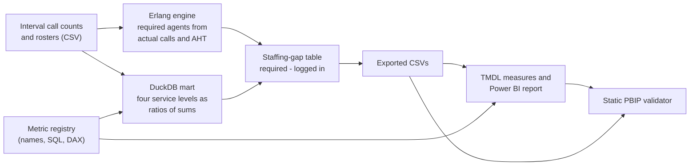

# servicelevel

[](https://github.com/sharmaaman8588-hue/servicelevel/actions/workflows/ci.yml)


servicelevel computes contact-centre service level under four abandon rules, always as a ratio of sums, and sets it beside an Erlang C staffing requirement per half hour. A DuckDB mart is the reference implementation; a Power BI project (PBIP: TMDL semantic model plus report) presents the same figures, and a static validator checks that the Power BI files still agree with the mart's CSV columns and with a single Python metric registry. All data is synthetic and generated by a seeded script in this repository.

## The problem

Analysts in a home-broadband provider's customer contact centre report service level every day, yet the same queue scores 71% or 84% depending on how abandoned calls are counted, and averaging half-hour percentages lets quiet overnight intervals hide a failing lunchtime peak. Without a per-interval staffing view nobody can say whether a missed target came from too few agents or from the definition.

The four definitions at threshold T (here 20 seconds) differ only in how a call that was abandoned is treated:

| Definition | Formula | Abandoned calls |
|---|---|---|
| SL1 | answered within T / offered | count against the queue |
| SL2 | answered within T / answered | ignored |
| SL3 | answered within T / (offered - abandoned within T) | ignored if they hung up inside T |
| SL4 | (answered within T + abandoned within T) / offered | count as served if they hung up inside T |

Because an abandoned call is in `offered` but not `answered`, and a call abandoned within T is also in `abandoned`, SL1 <= SL3 <= min(SL2, SL4) holds for any data. The test suite asserts it on every row.

## How it works



* `src/servicelevel/synth.py` writes 8,064 half-hour rows (3 queues x 8 weeks x 48 intervals) with planted patterns.
* `src/servicelevel/erlang.py` computes Erlang B by recurrence, Erlang C from it, service level, ASA, required agents with an occupancy cap, and shrinkage.
* `sql/` holds the mart views: interval service levels, the staffing fact, weekly and period aggregates, and the weekday x half-hour grid.
* `src/servicelevel/registry.py` lists the ten measures once; the SQL columns, the DAX and the validator all come from or are checked against it.
* `src/servicelevel/pbip.py` writes `powerbi/`; `src/servicelevel/pbip_validate.py` checks it.

The synthetic data carries these planted patterns, and the tests recover each one:

* **billing** is rostered 3 agents below the Erlang requirement on Tuesdays and Wednesdays 11:00-14:00, and its overnight intervals carry 1-4 calls that are all answered within T;
* **technical** has an IVR misroute that makes 10% of offered calls hang up within 10 seconds;
* **sales** is rostered 2 agents above requirement, so abandonment stays under 2%.

## Quick start

```bash
uv venv --python 3.12 .venv            # any Python 3.11+
uv pip install --python .venv/bin/python -e ".[dev]"
source .venv/bin/activate

servicelevel generate                  # data/raw/interval.csv (seeded, 8,064 rows)
servicelevel build                     # DuckDB mart -> data/mart/*.csv and powerbi/ files
servicelevel sl                        # all queues over the 8 weeks
servicelevel sl --queue billing --week 2025-W10
servicelevel staffing --queue billing --date 2025-03-04
servicelevel staffing --queue billing --top 8
servicelevel erlang --calls 100 --aht 180 --interval 1800 --target 0.8 --threshold 20
servicelevel validate-pbip

pytest -q
```

The mart CSVs are committed under `data/mart/` (about 580 KB). To regenerate them and the `powerbi/` files, run `servicelevel generate && servicelevel build`; the tests check the committed CSVs by schema, row counts, identities and recovery of the planted patterns rather than by exact bytes, so a different numpy or pandas release does not break them. So `sl`, `staffing` and `validate-pbip` work straight after installing. To open the report, enable the "Power BI Project (.pbip)" preview feature in Power BI Desktop, open `powerbi/ServiceLevel.pbip`, and set the `DataFolder` parameter (Transform data, Manage parameters) to the absolute path of `data/mart`.

## Example output

All figures below come from `servicelevel` run on the seeded data (seed 42).

Per-queue service level over the 8 weeks (`servicelevel sl`). `SL1 interval mean` is the unweighted mean of the 2,688 half-hour SL1 values and is shown only as a contrast:

```text
                                         All weeks: ratio of sums

  Queue       Offered     SL1     SL2     SL3     SL4   SL1 interval mean   Abandon   ASA (s)   Occupancy
 ─────────────────────────────────────────────────────────────────────────────────────────────────────────
  billing      21,326   67.4%   77.3%   68.5%   69.0%               82.6%     12.9%     116.4       42.1%
  technical    56,812   66.1%   81.3%   74.8%   77.7%               66.9%     18.8%      82.9       54.4%
  sales        39,555   93.9%   94.9%   94.3%   94.4%               97.0%      1.1%       7.1       34.6%

```

Billing's call-weighted SL1 is 67.4% but the mean of its interval percentages is 82.6%: 18 overnight half hours a day, each with one to four calls and a perfect score, pull the average up while the lunchtime peak fails. Technical's SL4 sits 11.6 points above SL1 because 10% of its calls hang up inside 10 seconds. Sales stays within about one point across all four definitions.

The textbook Erlang C case, 100 calls per half hour at 180 s AHT (`servicelevel erlang --calls 100 --aht 180 --interval 1800 --target 0.8 --threshold 20`):

```text

  Offered load A (Erlangs)              10.00
  Required agents for 80% in 20 s          14
  Service level at that headcount      0.8884
  Service level with one fewer agent   0.7956
  Probability of waiting, C(N, A)      0.1741
  ASA (s)                                 7.8
  Occupancy                             71.4%
  Scheduled agents at 0% shrinkage         14

```

Thirteen agents would give 79.6%; fourteen give 88.8%.

The billing intervals with the largest staffing gap (`servicelevel staffing --queue billing --top 8`). Every one is a Tuesday or Wednesday lunchtime in the planted window, with at least 5 agents fewer logged in than the calls required:

```text
                    billing: 8 intervals with the largest staffing gap

  Interval               Offered   AHT (s)   Required   Rostered   Logged in   Gap    SL1
 ─────────────────────────────────────────────────────────────────────────────────────────
  Tue 2025-04-15 11:00        31       335          9          4           2    +7   0.0%
  Tue 2025-04-08 12:00        39       301         10          5           4    +6   0.0%
  Tue 2025-03-18 11:30        36       296          9          5           3    +6   0.0%
  Wed 2025-04-02 12:00        29       316          8          4           2    +6   0.0%
  Tue 2025-03-11 12:00        37       311         10          5           5    +5   0.0%
  Tue 2025-04-08 12:30        33       318          9          4           4    +5   0.0%
  Tue 2025-03-04 12:00        30       305          8          5           3    +5   0.0%
  Wed 2025-03-05 12:00        29       294          8          4           3    +5   0.0%

```

## Design decisions

**Service level is only ever a ratio of sums.** Every aggregate in SQL and every DAX measure divides a sum by a sum, and a zero denominator gives NULL, never 0. The unweighted mean of interval SL1 exists in the mart (`sl1_interval_mean`) only so the gap can be shown and tested; it is not a Power BI measure, and the validator rejects `AVERAGE` or `AVERAGEX` over a percentage column or measure. The cost is that a Power BI visual cannot average a per-interval percentage column even when someone wants a "typical interval" view; that view needs its own, explicitly labelled measure.

**Erlang C goes through the Erlang B recurrence.** B(0) = 1 and B(n) = A*B(n-1) / (n + A*B(n-1)) keep every intermediate value in [0, 1], so a queue of 180 Erlangs needing 190 agents is as safe as a queue of ten, where the `A**N / N!` form overflows a double. The search for the required headcount advances the same recurrence one agent at a time, so it costs O(N) rather than O(N^2). The trade-off is that the maths is plain Python rather than SQL; the mart receives `required_agents` as an input column, which keeps one tested implementation instead of two.

**One registry for names, SQL and DAX.** `registry.py` holds each metric's DAX expression and an equivalent DuckDB aggregate. A test evaluates every registry aggregate against the hand-written SQL views, and the validator compares every TMDL measure to the registry text. This catches drift in either direction at the price of some duplication: the SQL views are still written out in full, because readable SQL matters more than generating it.

**Power BI is validated statically.** Power BI Desktop cannot run in CI, so the validator parses the TMDL and report JSON as text. It checks that every column a measure, relationship or visual uses exists in the exported CSV headers, that measure names and expressions equal the registry, and that no percentage is averaged. It does not evaluate DAX, so it cannot prove a measure returns the right number; the SQL mart and its pandas cross-check are the numerical reference, and the registry ties the two together.

**The generator is parametric, not a queue simulation.** Each interval's outcomes are drawn from Erlang C probabilities at the logged-in headcount, with a patience model in which the share of delayed calls that abandon is ASA / (ASA + 120 s), capped at 40%. That is enough to make staffing shortfalls produce realistic service-level and abandonment damage, and it is fast and reproducible, but it does not model call-by-call queue dynamics such as retrials or callbacks. An extra `wait_seconds` column (queue seconds of answered calls) is generated so that ASA is a ratio of sums like everything else.

**Agent figures are per-interval averages.** `Required Agents`, `Logged-in Agents` and `Staffing Gap` divide the summed agents by the number of distinct intervals in the filter, so a weekday x half-hour cell shows the average gap over eight weeks and a queue selection shows agents per interval. Selecting several queues sums their agents within each interval first. The occupancy cap defaults to 85% and the target to 80% in 20 seconds; both are parameters of `servicelevel.erlang`.

## Testing

```bash
pytest -q
```

```text
........................................................................ [ 81%]
................                                                         [100%]
88 passed in 9.03s
```

The suite includes the Erlang acceptance cases (A = 10, A = 24, A = 180 with no overflow, shrinkage and the occupancy cap), a hypothesis property test that checks `offered = answered + abandoned` and SL1 <= SL3 <= min(SL2, SL4) over random counts, a pandas recomputation of every aggregate to 1e-12, recovery of each planted pattern, structural checks of the committed CSVs and a byte-for-byte check that the Power BI files equal what the generator writes, and validator fixtures that rename a column, average a percentage and bind a visual to a missing field. Ruff runs in CI:

```bash
ruff check . && ruff format --check .
```

## Project layout

```text
.
|-- pyproject.toml
|-- sql/                       DuckDB mart views (staging, interval service, staffing, aggregates, grid)
|-- src/servicelevel/
|   |-- erlang.py              Erlang B/C, service level, ASA, required agents, shrinkage
|   |-- synth.py               seeded generator and its queues.yaml parameters
|   |-- mart.py                required agents, DuckDB mart, CSV export
|   |-- registry.py            ten metrics: names, SQL aggregate, DAX
|   |-- pbip.py                writes the PBIP project (Jinja2 template for TMDL tables)
|   |-- pbip_validate.py       static validator
|   `-- cli.py                 generate, build, sl, staffing, erlang, validate-pbip
|-- powerbi/
|   |-- ServiceLevel.pbip
|   |-- ServiceLevel.SemanticModel/   TMDL: Interval, Queue, Calendar, TimeOfDay, relationships, DataFolder
|   `-- ServiceLevel.Report/          definition.pbir, report.json (three pages)
|-- data/mart/                 exported CSVs the model loads
|-- tests/
`-- .github/workflows/ci.yml
```

## License

MIT. See `LICENSE`.

## Maintainer

Maintained by **Aman Sharma**, Project Manager focused on electrical infrastructure, power systems, and T&D. Aman brings project delivery experience across infrastructure portfolios, with strengths in scheduling, budget forecasting, risk mitigation, contractor coordination, and stakeholder management.

For project questions or maintenance discussions, contact [Aman Sharma](mailto:sharma.aman8588@gmail.com).